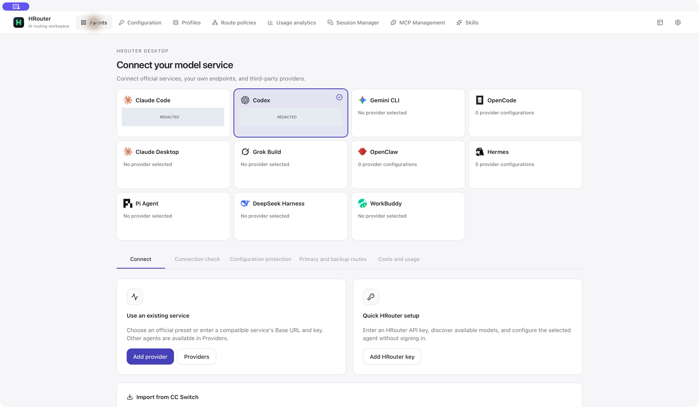
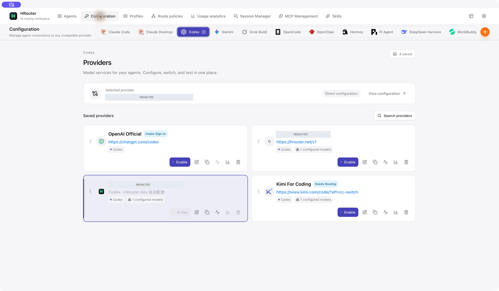
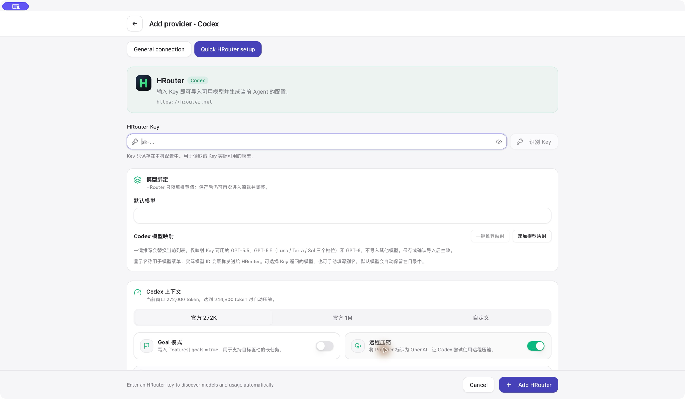
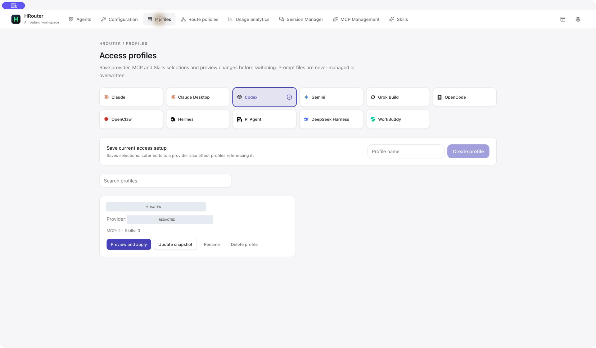
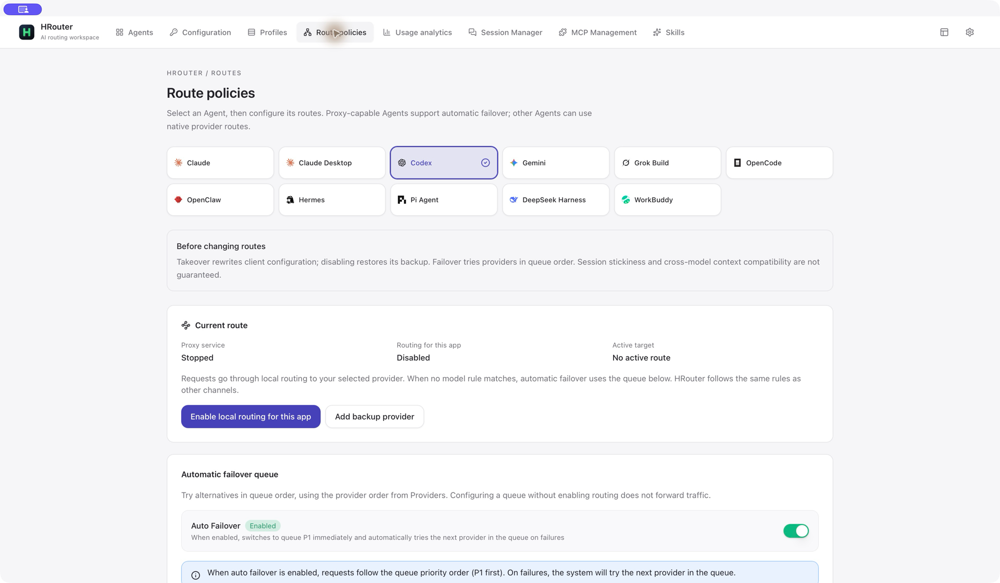
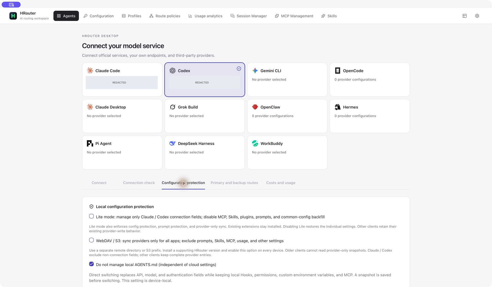
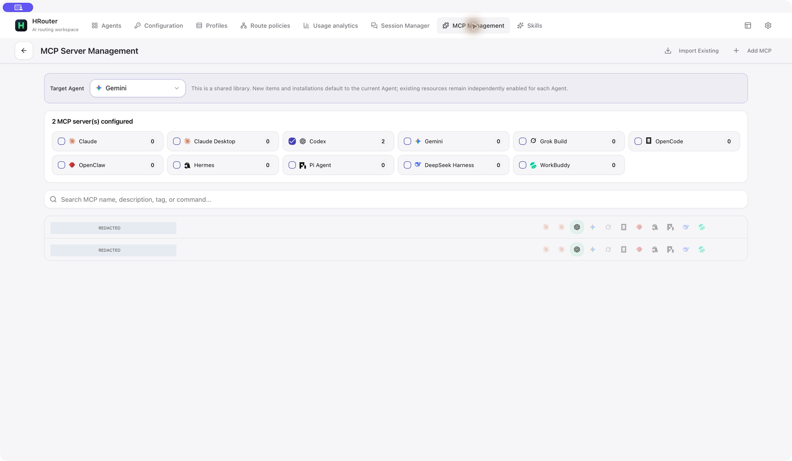
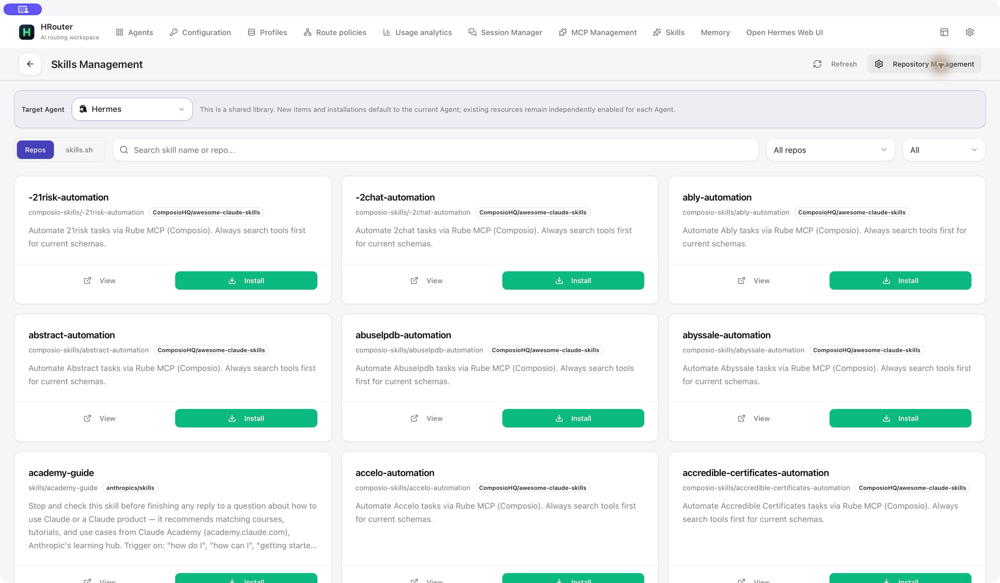
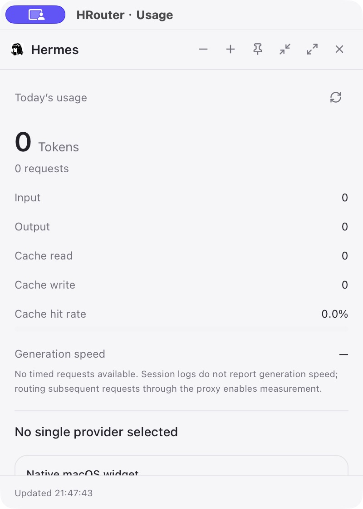

<div align="center">

**English** · [简体中文](README_ZH.md)

[HRouter](https://hrouter.net/home) · [All public projects](https://github.com/honestTai) · [Star & Fork trends](#project-activity)

</div>

[](#project-activity)

<div align="center">


# HRouter Desktop

### Less configuration. More coding.

**A local desktop workbench for Claude Code, Codex, and your other AI coding agents.**<br>
Built on [CC Switch](https://github.com/farion1231/cc-switch). Optional [HRouter](https://hrouter.net/) setup uses one OpenAI-compatible API key for Claude, GPT, Gemini, and the other models that key can call.

[](https://github.com/honestTai/HRouter-Desktop/releases/latest)
[](https://github.com/honestTai/HRouter-Desktop/releases/download/v0.4.2/HRouter_0.4.2_aarch64.dmg)
[](https://github.com/honestTai/HRouter-Desktop/releases/download/v0.4.2/HRouter_0.4.2_x64-setup.exe)
[](#download)
[](LICENSE)

**English** | [简体中文](README_ZH.md)

[Download v0.4.2](#download) · [Quick start with HRouter](#quick-start-with-hrouter) · [Claude Code and Codex](#use-the-same-key-in-claude-code-and-codex) · [Why HRouter Desktop](#why-hrouter-desktop) · [Screenshots](#screenshots) · [Compared with CC Switch](#compared-with-cc-switch)

</div>



Claude Code, Codex, Gemini CLI, Grok Build, OpenCode, and six more agents in one local app: providers, API keys, model mappings, backup routes, and usage. [More screenshots](#screenshots).

## Download

**Current release: [v0.4.2](https://github.com/honestTai/HRouter-Desktop/releases/tag/v0.4.2)** (2026-10-09).

| Platform    | Package                                                                                                                          | Architecture                         |
| ----------- | -------------------------------------------------------------------------------------------------------------------------------- | ------------------------------------ |
| **macOS**   | [HRouter_0.4.2_aarch64.dmg](https://github.com/honestTai/HRouter-Desktop/releases/download/v0.4.2/HRouter_0.4.2_aarch64.dmg)     | Apple Silicon (M-series) · macOS 12+ |
| **Windows** | [HRouter_0.4.2_x64-setup.exe](https://github.com/honestTai/HRouter-Desktop/releases/download/v0.4.2/HRouter_0.4.2_x64-setup.exe) | x64                                  |

Intel Macs are not a supported install target. The published updater covers signed, notarized macOS Apple Silicon and Windows x64. After you install, the app can check for a newer release. [Release notes](https://github.com/honestTai/HRouter-Desktop/releases/tag/v0.4.2) · [all versions](https://github.com/honestTai/HRouter-Desktop/releases).

[Changelog](CHANGELOG.md) · [Code-signing policy](CODE_SIGNING_POLICY.md)

## Quick start with HRouter

[HRouter](https://hrouter.net/) is an API relay for coding tools such as Claude Code and Codex. You top up on the website, create one API key, and choose a group. That group decides which Claude, GPT, Gemini, and other models the key can call, and what they cost. The desktop app does not include account, top-up, or order pages. No HRouter account is required to use other providers.

1. **Create a key on the website.** Sign in at [hrouter.net](https://hrouter.net/). Check models and groups, then create a key from **API 密钥** and pick a group that matches the tool you want. Balance, subscription benefits, and key groups are separate: topping up does not grant every group. The order of steps is in the [HRouter docs](https://www.hrouter.net/docs/index).
2. **Install [v0.4.2](#download).** Open the workbench and select an agent. Claude Code and Codex are the usual starting points.
3. **Add the key in the app.** Choose **Add HRouter key**, paste the key, and click **识别 Key**. The app reads the models that key can actually call. That button label stays Chinese when the interface is set to English. The key is stored only in the local configuration.
4. **Review, save, and enable.** Check the model mapping, then enable the provider. Refresh or restart the client if it was already open.

Official providers, a self-hosted endpoint, or another OpenAI-compatible LLM gateway use the same workbench. HRouter quick setup is optional.

## Use the same key in Claude Code and Codex

You can also point the CLIs at HRouter yourself. These base URLs are from the [HRouter docs](https://www.hrouter.net/docs/index). Website paths such as `/home` and `/keys` are not API addresses.

| Client                                         | Base URL                  | Guide                                                                 |
| ---------------------------------------------- | ------------------------- | --------------------------------------------------------------------- |
| Claude Code (Anthropic Messages)               | `https://hrouter.net`     | [Claude Code tutorial](https://www.hrouter.net/docs/claude-code)      |
| Codex and other OpenAI-compatible clients      | `https://hrouter.net/v1`  | [Codex tutorial](https://www.hrouter.net/docs/codex)                  |

Claude Code appends `/v1/messages` itself. Setting its base URL to `https://hrouter.net/v1` returns 404.

`~/.claude/settings.json` on macOS and Linux, or `%USERPROFILE%\.claude\settings.json` on Windows:

```json
{
  "env": {
    "ANTHROPIC_BASE_URL": "https://hrouter.net",
    "ANTHROPIC_AUTH_TOKEN": "sk-xxxxx"
  }
}
```

Replace `sk-xxxxx` with your key. If your Claude Code build reads `ANTHROPIC_API_KEY` instead, use the same key there.

Codex uses the OpenAI Responses API. The provider block in `~/.codex/config.toml` (Windows: `%USERPROFILE%\.codex\config.toml`):

```toml
model_provider = "hrouter"

[model_providers.hrouter]
name = "OpenAI"
base_url = "https://hrouter.net/v1"
requires_openai_auth = true
wire_api = "responses"
```

Put the key in `~/.codex/auth.json` as `OPENAI_API_KEY`. The docs require `name = "OpenAI"` exactly, so Codex remote compaction can run, and `wire_api = "responses"`. Model ids change; pick one your key returns from `https://hrouter.net/v1/models`. Context-window presets and the rest of the file are in the [Codex tutorial](https://www.hrouter.net/docs/codex).

**识别 Key** in HRouter Desktop writes this configuration for the selected agent. Keep manual edits and the desktop app pointed at the same base URL.

## Why HRouter Desktop?

Different agents. Different config files. Different providers. Switching your coding setup should not mean piecing all of them together again.

**HRouter Desktop puts the connection workflow in one place:** providers, API keys, model mappings, configuration protection, backup routes, and usage. Built on CC Switch, it is a desktop CC Switch alternative: an agent-first interface for the services you choose, including an OpenAI-compatible API relay or another LLM gateway.

- **11 agents, one workbench.** Move between Claude Code, Codex, Gemini CLI, and more without learning a different configuration UI for each.
- **Switch with a preview, not a guess.** Opt into Claude / Codex configuration protection to preserve custom fields, preview changes, and keep local switch snapshots.
- **Give your models a backup plan.** Choose primary and backup providers, define exact-model routes, and use automatic failover through supported local routing.
- **Keep repeatable setups.** Save provider, MCP, and Skill selections as access profiles; review them before applying.
- **See how your tools are being used.** Inspect requests, tokens, cache usage, and estimated costs, with an agent-scoped floating usage window.
- **Use the service you want.** Official providers, self-hosted endpoints, and compatible gateways are welcome. No HRouter account is required to use the desktop app.

## Features

### Connect and check

- **Provider library:** official presets and custom endpoints, multiple saved providers per agent, editable keys and model mappings.
- **HRouter quick setup:** key-based model discovery and agent-specific configuration, without a platform login.
- **Connection checks:** inspect the model catalog, then optionally test text responses, streaming, tool calls, and tool-result continuation. Real-request checks support Claude / Codex API-key providers and require acknowledgement of possible charges.

### Protect and reuse

- **Configuration protection:** opt-in field-preserving Claude / Codex switching, change previews, local snapshots, and conflict-checked restore.
- **Lite mode:** focus on connection settings without application-managed MCP, Skills, or prompt writes. Includes prompt protection and provider-only sync scope.
- **Access profiles:** save and reapply provider, MCP, and Skill selections. Profiles reference your providers; they are not full configuration backups.
- **Environment targets:** preview and deploy supported Claude / Codex API-key configurations to existing Windows / WSL-accessible directories.

### Route and observe

- **Primary and backup routes:** ordered failover queues and exact-model route chains through the local proxy. You choose the providers; HRouter is not automatically added.
- **Usage analytics:** request logs, token and cache breakdowns, trends, provider/model summaries, and local cost estimates.
- **Provider usage:** query configured provider usage interfaces; inspect multi-key quotas with explicit rules for combining independent balances.
- **Desktop visibility:** a floating agent usage window and macOS widget integration.

### Manage your agent workspace

- **Sessions:** browse supported local agent conversations and resume work in the relevant client.
- **MCP and Skills:** manage shared resources with per-agent enablement, Skills discovery, and supported import/export and backup workflows.
- **Agent-specific tools:** OpenClaw workspace files, environment variables, tool permissions, and defaults; Hermes memory and user-profile editing.
- **Everyday utilities:** CLI installation/update entry points, language and theme preferences, and in-app help.

### Supported agents

**Claude Code · Claude Desktop · Codex · Gemini CLI · Grok Build · OpenCode · OpenClaw · Hermes · Pi Agent · DeepSeek Harness · WorkBuddy**

Each agent has its own adapter. Routing, configuration protection, authentication, MCP, Skills, and usage support vary by agent; the CLI installer does not install every agent's desktop application. See the [integration guide](docs/access-workbench.md) for scope and behavior.

## Screenshots

Real macOS application captures with private configuration labels redacted. Some HRouter-specific controls still display Chinese when the interface is set to English. [Capture details and full image index](assets/screenshots/README.md).

|                     **Providers in one place**                     |                     **HRouter key quick setup**                      |
| :----------------------------------------------------------------: | :------------------------------------------------------------------: |
|  |  |
|        Keep saved services and the active provider visible.        |          Discover models and review mappings before saving.          |

|              **Reusable access profiles**              |                 **Explicit backup routes**                  |
| :----------------------------------------------------: | :---------------------------------------------------------: |
|  |  |
|            Save a setup you can return to.             |       Choose the order in which providers are tried.        |

<details>
<summary><strong>Configuration protection, MCP, Skills, and desktop usage</strong></summary>

|                  **Protect local configuration**                  |             **Manage MCP resources**             |
| :---------------------------------------------------------------: | :----------------------------------------------: |
|  |  |





</details>

## Compared with CC Switch

**CC Switch provides the foundation. HRouter Desktop changes how you work with it.** We retain the upstream provider, proxy, MCP, Skills, session, and usage foundations rather than presenting them as new inventions.

| Focus                                | What this fork changes                                                                                                                            |
| ------------------------------------ | ------------------------------------------------------------------------------------------------------------------------------------------------- |
| **Agent-first interface**            | A redesigned workbench and top navigation, with dedicated Configuration, Profiles, Route policies, and Usage pages.                               |
| **Deliberate configuration changes** | A protection workflow with previews, fingerprint checks, snapshots, guarded restores, Lite mode, and prompt protection.                           |
| **Repeatable access setups**         | Dedicated profiles for provider, MCP, and Skill selections, with a preview before application.                                                    |
| **Model-aware routing**              | Extensions to inherited routing: exact-model primary/backup chains, temporary manual preferences, and controlled multi-key quota aggregation.     |
| **Compatibility and continuity**     | Protocol-aware connection checks, targeted proxy transport fixes, and Codex legacy-provider compatibility without rewriting conversation history. |
| **Usage correctness**                | Targeted fixes for Codex fork usage, Claude cache-TTL estimates, and OpenCode rollup/deduplication.                                               |
| **HRouter and desktop integration**  | Optional HRouter key setup, DeepSeek Harness / WorkBuddy integration work, and agent-scoped desktop usage tools.                                  |
| **A focused desktop**                | v0.4.0 removes the account, payment, order, and cloud-billing modules from earlier **HRouter** versions—not from CC Switch.                       |

This is a summary of changes maintained in this fork, not a claim that current upstream lacks every listed capability. The projects evolve independently. For implementation details and validation limits, see the [workbench guide](docs/access-workbench.md), [fix checklist](docs/issue-remediation.md), and [upstream contribution records](docs/upstream-contributions.md).

## Get started

1. **Install and choose an agent.** Open the workbench and select the coding tool you want to configure.
2. **Connect a service.** Add a provider preset or a custom endpoint and key. For HRouter, select **Add HRouter key** and review the discovered models.
3. **Review, save, and enable.** Check the model mapping and configuration, then enable the provider. Refresh or restart the target client if required.

That's the basic setup. Add protection, profiles, or backup routes when you need them; opt into a billable connection test only after checking the catalog.

### Moving from CC Switch?

Use **Agents → Connect → Import from CC Switch** to preview your actual `cc-switch.db` file read-only and select providers to import. The importer does not change the source database, overwrite existing entries, or activate imported providers.

This imports providers—not a whole account. Managed OAuth sessions, prompts, Skills, usage scripts, and OMO configuration are excluded. Existing HRouter users do not need to delete their keys or configuration directories to upgrade.

## Good to know

- **Local-first, not offline-only.** Provider calls, model discovery, usage queries, Skills discovery, pricing, and updates contact the relevant services. Treat local keys, configuration files, and snapshots as sensitive.
- **Estimates, not invoices.** Usage depends on available local records and configured prices. A passing connection check is not a guarantee of model identity, quality, or long-task reliability.
- **Protection has a scope.** It is opt-in for Claude / Codex. Restore checks preserve later edits rather than forcing an overwrite; provider-only sync and profiles are not full backups.
- **Signing types differ.** Tauri updater signatures are not Windows Authenticode signatures. macOS publication requires Developer ID signing and notarization.

[Privacy](PRIVACY.md) · [Security](SECURITY.md) · [Signing](CODE_SIGNING_POLICY.md)

## Build and contribute

Built with **Tauri 2 · Rust · React · TypeScript**. Use the project lockfile, `pnpm@10.12.3`, and your platform's Tauri build prerequisites.

```bash
git clone https://github.com/honestTai/HRouter-Desktop.git
cd HRouter-Desktop
pnpm install --frozen-lockfile
pnpm dev
```

`pnpm build` builds for the host platform. See [Contributing](CONTRIBUTING.md) for checks and contribution guidelines, and [macOS signing](docs/macos-signing.md) for release setup.

Found a bug or have a workflow to improve? [Open an issue](https://github.com/honestTai/HRouter-Desktop/issues). If HRouter Desktop is useful to you, give the repository a star.

## Credits and license

Based on **[CC Switch](https://github.com/farion1231/cc-switch)** by **Jason Young** and its contributors. HRouter Desktop is independently maintained by [honestTai](https://github.com/honestTai) and HRouter Contributors; it is not an official CC Switch release or endorsed by its maintainers.

The original copyright and MIT license are preserved. Some internal `cc-switch` identifiers remain for compatibility and migration.

[MIT License](LICENSE) · [Attribution](NOTICE.md)

---

<a id="project-activity"></a>

## Project activity

Star / Fork totals and retained-event history, scheduled to refresh daily.

[](https://github.com/honestTai/honestTai/blob/main/data/README.md)

[Observed daily totals](https://raw.githubusercontent.com/honestTai/honestTai/main/assets/metrics/HRouter-Desktop-daily.svg) · [Methodology](https://github.com/honestTai/honestTai/blob/main/data/METHODOLOGY.md) · [All public projects](https://github.com/honestTai)

<sub>Historical curves reconstruct currently retained stars and visible forks, not historical net totals. Separate daily observations start on 2026-10-06; no fabricated backfill.</sub>
