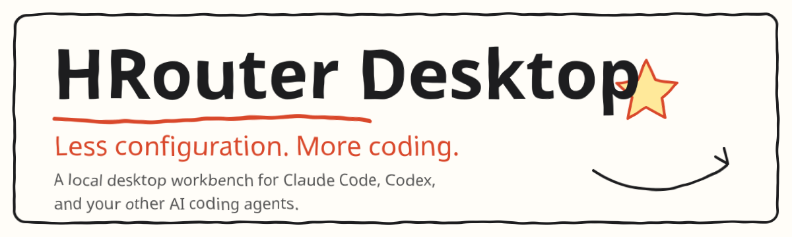

<div align="center">

<picture>
  <source media="(prefers-color-scheme: dark)" srcset="docs/assets/hero.svg">
  
</picture>

**Claude Code, Codex, Gemini CLI, Grok Build, OpenCode, and six more agents in one local app: providers, API keys, model mappings, backup routes, and usage.**

[HRouter](https://hrouter.net/home) · [Docs](docs/access-workbench.md) · [Contact](mailto:honesttibo@mail.grokbot.com)

**English** · [简体中文](README_ZH.md)

</div>

## Quick start

**Current release: [v0.4.2](https://github.com/honestTai/HRouter-Desktop/releases/tag/v0.4.2)** (2026-10-09).

| Platform | Package | Architecture |
| :--- | :--- | :--- |
| **macOS** | [HRouter_0.4.2_aarch64.dmg](https://github.com/honestTai/HRouter-Desktop/releases/download/v0.4.2/HRouter_0.4.2_aarch64.dmg) | Apple Silicon (M-series) · macOS 12+ |
| **Windows** | [HRouter_0.4.2_x64-setup.exe](https://github.com/honestTai/HRouter-Desktop/releases/download/v0.4.2/HRouter_0.4.2_x64-setup.exe) | x64 |

Intel Macs are not a supported install target. The published updater covers signed, notarized macOS Apple Silicon and Windows x64.

1. **Install [v0.4.2](https://github.com/honestTai/HRouter-Desktop/releases/tag/v0.4.2).** Open the workbench and select an agent. Claude Code and Codex are the usual starting points.
2. **Add a provider.** Choose an official preset, or add a custom endpoint and API key. The app can inspect the provider's model catalog so you can review the models it can actually call. Keys are stored only in the local configuration.
3. **Review, save, and enable.** Check the model mapping, then enable the provider. Refresh or restart the client if it was already open.

Official providers, a self-hosted endpoint, or another OpenAI-compatible LLM gateway all use the same workbench. [HRouter](https://hrouter.net/home) is the companion relay for prepaid model access. One API key covers Claude, GPT, Gemini, and Grok for your coding agents.

Use **Agents → Connect → Import from CC Switch** to preview your actual `cc-switch.db` file read-only and select providers to import. The importer does not change the source database, overwrite existing entries, or activate imported providers.

Built with **Tauri 2 · Rust · React · TypeScript**. Use the project lockfile and `pnpm@10.12.3`.

```bash
git clone https://github.com/honestTai/HRouter-Desktop.git
cd HRouter-Desktop
pnpm install --frozen-lockfile
pnpm dev
```

`pnpm build` builds for the host platform.

## Core features

| Area | What it does |
| :--- | :--- |
| Providers | Official presets and custom endpoints, multiple saved providers per agent, editable keys and model mappings |
| Configuration protection | Opt-in field-preserving Claude / Codex switching, change previews, local snapshots, and conflict-checked restore |
| Routes | Primary and backup providers, exact-model route chains, and automatic failover through supported local routing. You choose the providers; nothing is added automatically |
| Usage | Request logs, token and cache breakdowns, trends, provider/model summaries, and local cost estimates |
| Profiles and workspace | Save and reapply provider, MCP, and Skill selections. Browse supported local sessions and manage MCP and Skills |

**Claude Code · Claude Desktop · Codex · Gemini CLI · Grok Build · OpenCode · OpenClaw · Hermes · Pi Agent · DeepSeek Harness · WorkBuddy**

Each agent has its own adapter. Routing, configuration protection, authentication, MCP, Skills, and usage support vary by agent. See the [integration guide](docs/access-workbench.md).

## Docs

- **[User manual](docs/user-manual/en/README.md)** · **[Access workbench](docs/access-workbench.md)** · **[Usage widgets](docs/usage-widgets.md)** · **[Claude Desktop sessions](docs/claude-desktop-sessions.md)**
- **[Changelog](CHANGELOG.md)** · **[Contributing](CONTRIBUTING.md)** · **[macOS signing](docs/macos-signing.md)** · **[Screenshots](assets/screenshots/README.md)**
- **[Privacy](PRIVACY.md)** · **[Security](SECURITY.md)** · **[Support](SUPPORT.md)** · **[Code-signing policy](CODE_SIGNING_POLICY.md)**
- **[Upstream contributions](docs/upstream-contributions.md)** · **[Issue remediation](docs/issue-remediation.md)**

## License

Based on **[CC Switch](https://github.com/farion1231/cc-switch)** by **Jason Young** and its contributors. HRouter Desktop is independently maintained by [honestTai](https://github.com/honestTai) and HRouter Contributors; it is not an official CC Switch release or endorsed by its maintainers.

The original copyright and MIT license are preserved. Some internal `cc-switch` identifiers remain for compatibility and migration.

[MIT License](LICENSE) · [Attribution](NOTICE.md)

We retain the upstream provider, proxy, MCP, Skills, session, and usage foundations rather than presenting them as new inventions. Records: [upstream contributions](docs/upstream-contributions.md).

## Star history

<a href="https://www.star-history.com/#honestTai/HRouter-Desktop&Date"><picture><source media="(prefers-color-scheme: dark)" srcset="https://api.star-history.com/svg?repos=honestTai/HRouter-Desktop&type=Date&theme=dark"></picture></a>

---

<div align="center">

Made by **[honestTai](https://github.com/honestTai)** · [HRouter](https://hrouter.net/home) · [More projects](https://github.com/honestTai)

</div>
