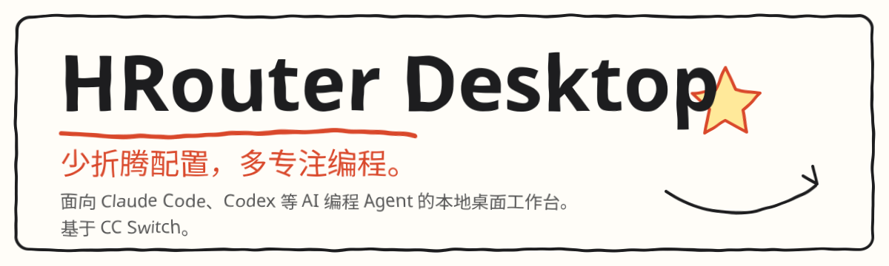

<div align="center">

<picture>
  <source media="(prefers-color-scheme: dark)" srcset="docs/assets/hero.zh-CN.svg">
  
</picture>

**Claude Code、Codex、Gemini CLI、Grok Build、OpenCode，再加上另外 6 个 Agent，放在同一个本地应用里：供应商、API Key、模型映射、备用线路和用量。**

[HRouter](https://hrouter.net/home) · [文档](docs/access-workbench.md) · [联系](mailto:honesttibo@mail.grokbot.com)

[English](README.md) · **简体中文**

</div>

## 快速开始

**当前版本：[v0.4.2](https://github.com/honestTai/HRouter-Desktop/releases/tag/v0.4.2)**（2026-10-09）。

| 平台 | 安装包 | 架构 |
| :--- | :--- | :--- |
| **macOS** | [HRouter_0.4.2_aarch64.dmg](https://github.com/honestTai/HRouter-Desktop/releases/download/v0.4.2/HRouter_0.4.2_aarch64.dmg) | Apple Silicon（M 系列）· macOS 12+ |
| **Windows** | [HRouter_0.4.2_x64-setup.exe](https://github.com/honestTai/HRouter-Desktop/releases/download/v0.4.2/HRouter_0.4.2_x64-setup.exe) | x64 |

不支持 Intel Mac。已发布的自动更新覆盖已签名、已公证的 macOS Apple Silicon 和 Windows x64。

1. **安装 [v0.4.2](https://github.com/honestTai/HRouter-Desktop/releases/tag/v0.4.2)。** 打开工作台并选择 Agent。通常从 Claude Code 或 Codex 开始。
2. **添加供应商。** 选择官方预设，或填写自定义端点与 API Key。应用可以检查供应商的模型目录，确认这把 Key 实际能调用的模型。Key 只保存在本机配置中。
3. **检查、保存、启用。** 确认模型映射后再启用供应商。客户端若已打开，按需刷新或重启。

官方供应商、自建端点，或其他 OpenAI 兼容的 LLM 网关，都使用同一个工作台。[HRouter](https://hrouter.net/home) 是配套的预付费模型 API 中继。一把 API Key 即可在编程 Agent 中使用 Claude、GPT、Gemini 和 Grok。

在 **工作台 → 开放接入 → 从 CC Switch 迁移** 中选择实际的 `cc-switch.db` 文件，只读预览后再导入所需供应商。导入器不会修改源数据库、覆盖已有条目或激活导入的供应商。

技术栈：**Tauri 2 · Rust · React · TypeScript**。请使用项目锁文件、`pnpm@10.12.3`。

```bash
git clone https://github.com/honestTai/HRouter-Desktop.git
cd HRouter-Desktop
pnpm install --frozen-lockfile
pnpm dev
```

`pnpm build` 为当前平台构建安装包。

## 核心功能

| 方面 | 做什么 |
| :--- | :--- |
| 供应商 | 官方预设与自定义端点，每个 Agent 可保存多套供应商，Key 和模型映射可编辑 |
| 配置保护 | 主动开启 Claude / Codex 字段保留式切换、变更预览、本地快照及冲突检查恢复 |
| 线路 | 主备供应商、精确模型线路链，以及支持的本地代理自动故障转移。供应商由你选择，不会自动加入 |
| 用量 | 请求日志、Token 与缓存明细、趋势、供应商/模型汇总，以及本地费用估算 |
| 方案与工作区 | 保存并重新应用供应商、MCP 和 Skills 选择；浏览支持的本地会话，管理 MCP 与 Skills |

**Claude Code · Claude Desktop · Codex · Gemini CLI · Grok Build · OpenCode · OpenClaw · Hermes · Pi Agent · DeepSeek Harness · WorkBuddy**

每个 Agent 使用独立适配器。线路、配置保护、认证、MCP、Skills 和用量的支持范围因 Agent 而异。具体范围与行为见[接入说明](docs/access-workbench.md)。

## 文档

- **[用户手册](docs/user-manual/zh/README.md)** · **[接入说明](docs/access-workbench.md)** · **[用量小组件](docs/usage-widgets.md)** · **[Claude Desktop 会话](docs/claude-desktop-sessions.md)**
- **[更新记录](CHANGELOG.md)** · **[贡献指南](CONTRIBUTING.md)** · **[macOS 签名说明](docs/macos-signing.md)** · **[界面截图](assets/screenshots/README.md)**
- **[隐私政策](PRIVACY.md)** · **[安全反馈](SECURITY.md)** · **[获取帮助](SUPPORT.md)** · **[代码签名政策](CODE_SIGNING_POLICY.md)**
- **[上游贡献记录](docs/upstream-contributions.md)** · **[修复清单](docs/issue-remediation.md)**

## 许可证

基于 **Jason Young** 及贡献者开发的 **[CC Switch](https://github.com/farion1231/cc-switch)**。HRouter Desktop 由 [honestTai](https://github.com/honestTai) 与 HRouter Contributors 独立维护，不是 CC Switch 官方发行版，也不代表上游维护者背书。

项目保留原作者版权与 MIT 许可证。部分内部 `cc-switch` 标识继续用于兼容与迁移。

[MIT 许可证](LICENSE) · [归属声明](NOTICE.md)

我们保留上游的供应商、代理、MCP、Skills、会话和用量基础能力，不把它们包装成本项目的新发明。记录见[上游贡献记录](docs/upstream-contributions.md)。

## 星标历史

<a href="https://www.star-history.com/#honestTai/HRouter-Desktop&Date"><picture><source media="(prefers-color-scheme: dark)" srcset="https://api.star-history.com/svg?repos=honestTai/HRouter-Desktop&type=Date&theme=dark"></picture></a>

---

<div align="center">

Made by **[honestTai](https://github.com/honestTai)** · [HRouter](https://hrouter.net/home) · [More projects](https://github.com/honestTai)

</div>
